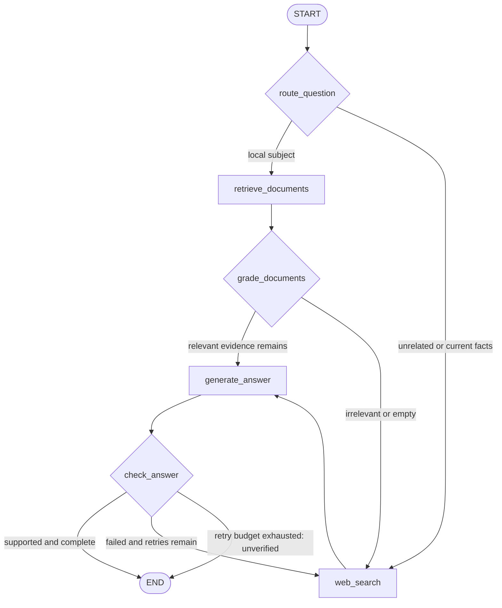

# Intelligent Adaptive RAG Assistant with LangGraph

A Python research assistant that chooses between a local knowledge base and web
search, grades retrieved passages, generates cited answers, and checks support and
completeness. Failed checks cause a bounded search-and-regenerate cycle.
Both the language model and web search use Ollama Cloud; no local model download or
second search-service key is needed.

## Run

For the browser UI, install the dependencies below, then run:

```bash
.venv/bin/python -m streamlit run streamlit_app.py
```

Open `http://localhost:8501`. Enter a question and click **Research**. The page shows
the answer, evidence-check status, sources, and execution path. The sidebar lets you
adjust the retry limit. The app loads its API key and model from `.env`.

Requires Python 3.11+. Run commands from this project directory.

```bash
python3 -m venv .venv
source .venv/bin/activate
python -m pip install -e '.[dev]'
```

Create `.env` from `.env.example` **only if `.env` does not already exist**, then set
`OLLAMA_API_KEY`. The local `.env` is excluded from Git. Do not include it when
submitting or sharing the project.
`OLLAMA_MODEL` defaults to `gpt-oss:20b`; change it to an available cloud model if needed.

```bash
python -m streamlit run streamlit_app.py
python -m pytest -q
```

`requirements.lock` records the exact environment used for validation (Python 3.13.5
on macOS ARM64). The broader version ranges in `pyproject.toml` are suitable for a
fresh installation on another supported Python version.

Enter the eight questions from [`examples/questions.json`](examples/questions.json)
in the UI to try the assignment scenarios. Saved evaluation results are in
[`reports/live_evaluation.json`](reports/live_evaluation.json). Research runs make
real Ollama API calls; automated tests need no key or network. Set the sidebar's
retry limit to zero to disable regeneration. The default is two retries. Edit the
Markdown files in `knowledge_base/` to change the local corpus.

## Graph architecture



The compiled graph's Mermaid representation is saved in
[`reports/architecture.mmd`](reports/architecture.mmd).

## How LangGraph is used

| Concept | Implementation |
| --- | --- |
| **State** | `State`, a shared `TypedDict`, contains the question, evidence, route, draft, final answer, grader feedback, retry budget/counter, status, errors, and node trace. Nodes return partial updates. Fields use overwrite semantics; traces explicitly append to the previous list. |
| **Nodes** | Six Python functions perform routing, retrieval, relevance grading, web search, generation, and checking. They are registered by name with `StateGraph.add_node`. |
| **Edges** | Normal edges connect START → router, retrieval → grading, web search → generation, and generation → checking. These transitions always happen. |
| **Conditional edges** | `add_conditional_edges` selects a path after routing, document grading, and answer checking based on updated state. |
| **Routing** | An LLM compares the question with the local document catalog. It selects local retrieval for covered subjects and web search for unrelated subjects or current facts. This is a decision inside the graph, not a hard-coded question lookup. |
| **Loops** | A failed answer check returns to web search with a targeted query and feedback. Useful evidence is retained, URLs are deduplicated, and another answer is generated. |
| **START / END** | START enters the router. END is reached after verification or after the answer retry budget is exhausted. |
| **Persistence** | `InMemorySaver` checkpoints state under a thread ID. Each submitted question starts a fresh thread. The UI retains the latest result in session state; checkpoints are not durable cross-session chat memory. |

`retry_count` counts **additional generations**, not initial searches. With
`max_retries=2`, at most three answers are generated, regardless of which route was
taken. A direct web search or irrelevant-document fallback does not consume a retry.
The graph's recursion limit is a secondary safeguard above the longest allowed path.

## Implementation choices

- The five small teaching documents cover RAG, LangGraph, retrieval, and persistence.
  Local BM25 retrieval uses overlapping word chunks (220 words, stride 180) and
  returns up to three positive-scoring candidates. BM25 keeps the assignment focused
  on graph control flow and needs no embedding service.
- The document grader selects only useful retrieved IDs. Unknown IDs are ignored;
  no useful documents means web fallback. On grading or routing failures the system
  falls back conservatively and records the error.
- Ollama Cloud does not currently enforce structured outputs. Router/grader/checker
  responses are requested as JSON and validated with strict Pydantic schemas, with
  one repair attempt. The application does not send a Cloud `format` parameter.
- Generation uses supplied evidence and checker feedback. The checker first rejects
  missing/unknown source IDs, then asks the LLM to judge support **and** completeness.
  Citation punctuation is normalized (typographic hyphens and comma-separated IDs)
  before validation. Citation presence alone is not considered verification.
- Exhaustion yields `status="unverified"` and a limitation message. The unsupported
  `draft` remains in state for inspection but is not printed as a verified answer.
- Web results are evidence snippets, bounded to 6,000 characters per result. They
  may be incomplete or stale. LLM grading is fallible; `verified` means the checker
  accepted the answer, not a guarantee of objective truth.
- HTTP failures are sanitized and recorded without keys/headers. Transient HTTP
  errors have at most two transport retries, separate from graph retries. Prompts
  instruct the model to treat retrieved text as evidence rather than instructions.

## Testing and submission evidence

The eight live questions intentionally cover local concepts, unrelated web questions,
a local subject whose precise fact is absent, and a partially answerable question.
The `intended_path` is a hypothesis; the recorded `state.trace` is what actually ran.
Live model decisions may vary between runs.

`tests/test_workflow.py` separately runs eight distinct questions through the **real
compiled LangGraph**, using scripted provider decisions to guarantee coverage of
local success, direct web success, irrelevant-document fallback, successful retry,
and retry exhaustion. These are explicitly offline control-flow tests, not claims
about live model accuracy. Additional tests cover empty results, unavailable search,
unknown citations, zero retries, state checkpoints, input validation, JSON repair,
and sanitized API failures.

See [`reports/evaluation.md`](reports/evaluation.md) for recorded outcomes and
[`reports/offline_evaluation.json`](reports/offline_evaluation.json) for the eight
scripted runs with complete state and decision traces.

Project files:

| File | Purpose |
| --- | --- |
| `adaptive_rag/graph.py` | Shared workflow, six nodes, transitions, retry logic |
| `adaptive_rag/models.py` | State and decision schemas |
| `adaptive_rag/providers.py` | Ollama Cloud chat and web-search integration |
| `adaptive_rag/retrieval.py` | Markdown loading, chunking, BM25 retrieval |
| `streamlit_app.py` | Browser UI and application entry point |
| `adaptive_rag/__init__.py` | Marks the backend folder as a Python package |
| `knowledge_base/` | Editable local teaching corpus |
| `examples/questions.json` | Eight assignment questions |
| `tests/` | Offline behavior and provider tests |
| `reports/` | Saved execution evidence and graph architecture |

## References

- [LangGraph Graph API](https://docs.langchain.com/oss/python/langgraph/graph-api)
- [LangGraph persistence](https://docs.langchain.com/oss/python/langgraph/persistence)
- [Ollama Cloud authentication and model naming](https://docs.ollama.com/cloud)
- [Ollama web search](https://docs.ollama.com/capabilities/web-search)
- [Ollama structured-output limitations](https://docs.ollama.com/capabilities/structured-outputs)
